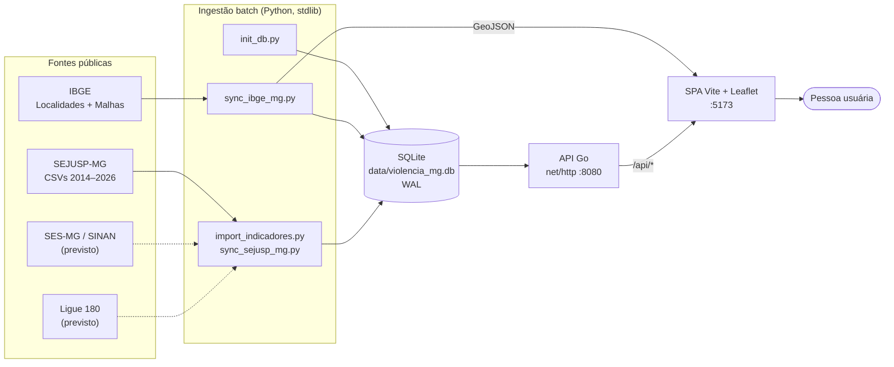

# Documentação — Mapa da Violência de Gênero (Minas Gerais)

Documentação técnica do projeto: arquitetura, contratos de API, modelo de dados,
pipeline de ingestão e operação local. Escrita em pt-BR, com diagramas Mermaid
renderizados nativamente no GitHub.

## Por onde começar

| Documento | Responde |
|---|---|
| [Visão geral](arquitetura/visao-geral.md) | Qual é o problema, quais componentes existem e quais decisões foram tomadas |
| [Backend (Go)](arquitetura/backend.md) | Endpoints, contratos JSON, concorrência, erros e limites da API |
| [Frontend (Vite + Leaflet)](arquitetura/frontend.md) | Como o mapa coroplético é montado, interações e recursos de segurança |
| [Banco de dados (SQLite)](arquitetura/banco-de-dados.md) | Schema, índices, volumetria e operação do arquivo SQLite em WAL |
| [Ingestão de dados](arquitetura/ingestao-de-dados.md) | De onde vêm os números, como são normalizados e como adicionar uma fonte |
| [Operação](arquitetura/operacao.md) | Rodar com Docker Compose ou nativo, bootstrap e troubleshooting |
| [Segurança e privacidade](arquitetura/seguranca-e-privacidade.md) | LGPD, agregação municipal, subnotificação e superfície de ataque |

## Arquitetura em uma imagem



## Convenções

- **Dados sensíveis:** nunca incluir nome, endereço ou qualquer dado individual de vítima. Só agregados municipais e taxas.
- **Escopo geográfico:** Minas Gerais (UF `31`), 853 municípios.
- **Diagramas:** Mermaid em blocos ` ```mermaid `; GitHub renderiza direto.
- **Números citados** (volumetria, contagens) refletem o banco local de referência descrito em [Banco de dados](arquitetura/banco-de-dados.md#volumetria-de-referência).
