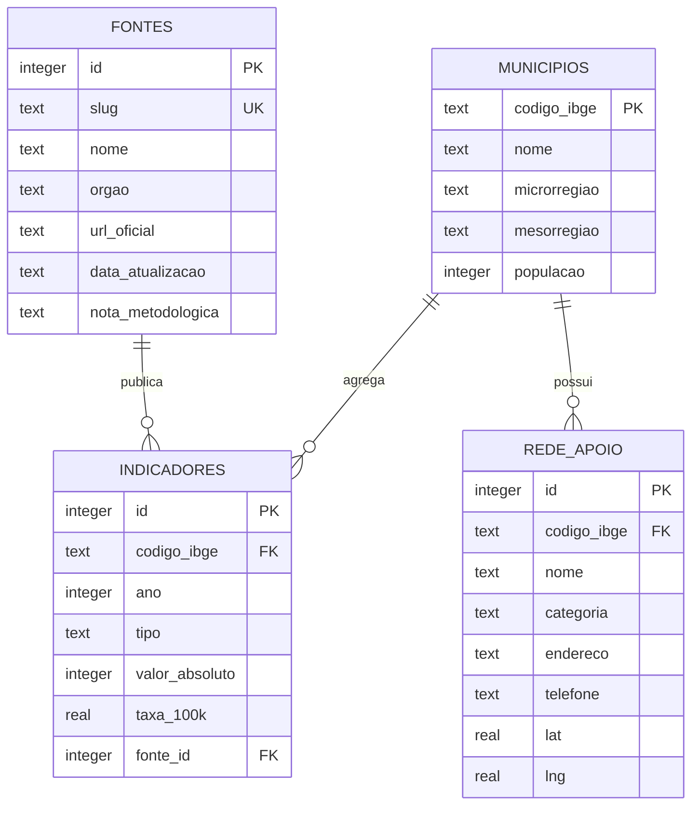

# Banco de dados — SQLite

## Por que SQLite

- Dataset atual: **12.701 indicadores**, 853 municípios, 3 fontes → cabe em 1,7 MB.
- Uso é leitura pública; escrita é batch (ingestão), fora do horário de request.
- Zero administração: o "banco" é um arquivo versionável no `.gitignore` e regenerável por script.
- `modernc.org/sqlite` dispensa CGO no lado Go; `sqlite3` da stdlib resolve o lado Python.

`PRAGMA journal_mode = WAL` (aplicado no schema **e** no DSN do backend): leitura
concorrente com a ingestão gravando. Efeito colateral operacional: existem
`violencia_mg.db-wal` e `-shm` ao lado do arquivo, e o processo Go fica preso ao
`-shm` antigo se outro processo fechar a última conexão → `docker compose restart backend`
depois de importar.

## Modelo



### `fontes`
Catálogo das origens. `slug` é a chave natural usada pelo importador
(`sejusp_mg`, `ses_mg`, `ligue180`). `nota_metodologica` é texto obrigatório que
aparece na UI — força declarar o viés da fonte. `data_atualizacao` é preenchida
pelo importador com a data da execução (`YYYY-MM-DD`).

### `municipios`
Espelho do IBGE para a UF 31: `codigo_ibge` de 7 dígitos como PK textual (nunca
inteiro — preserva zeros e evita conversão). `microrregiao`/`mesorregiao`
denormalizados para permitir filtro direto, sem tabela de hierarquia geográfica.

### `indicadores`
Fato agregado por `(município, ano, tipo, fonte)`. A `UNIQUE` é o contrato de
idempotência: o importador faz `ON CONFLICT ... DO UPDATE`, então rodar duas vezes
o mesmo CSV não duplica.

`tipo` é texto livre — valores em uso: `feminicidio`, `violencia_domestica`;
previstos: `violencia_saude`, `ligue_180`. `taxa_100k` é `REAL` e opcional:
preferida da coluna do CSV; se ausente, calculada como `valor_absoluto / populacao * 100000`.

### `rede_apoio`
Equipamentos de atendimento por município (DEAM, CREAS, Defensoria, Casa da
Mulher). `lat`/`lng` opcionais para eventual camada de pontos.

## Índices

| Índice | Colunas | Query que atende |
|---|---|---|
| `idx_indicadores_filtro` | `(tipo, ano, codigo_ibge)` | `LEFT JOIN` do `/api/mapa` e série por município |
| `idx_municipios_mesorregiao` | `(mesorregiao, nome)` | filtro `?mesorregiao=` + `ORDER BY nome` |
| `idx_rede_apoio_municipio` | `(codigo_ibge, categoria)` | detalhe do município |

## Volumetria de referência

| Tabela | Linhas |
|---|---|
| `fontes` | 3 |
| `municipios` | 853 |
| `indicadores` | 12.701 (`feminicidio` 1.613 em 2018–2026; `violencia_domestica` 11.088 em 2014–2026) |
| `rede_apoio` | 0 |
| Arquivo `.db` | ~1,7 MB |

## Operação

```bash
# criar schema + fontes (idempotente)
python3 scripts/init_db.py

# inspeção rápida
sqlite3 data/violencia_mg.db "SELECT tipo, COUNT(*), MIN(ano), MAX(ano) FROM indicadores GROUP BY tipo;"

# backup consistente (WAL): checkpoint antes de copiar
sqlite3 data/violencia_mg.db "PRAGMA wal_checkpoint(TRUNCATE);"
cp data/violencia_mg.db backup-$(date +%F).db

# integridade
sqlite3 data/violencia_mg.db "PRAGMA integrity_check;"
```

O schema é aplicado por `executescript` de `data/schema.sql` com `CREATE TABLE IF
NOT EXISTS` — **não há migrações versionadas**. Mudança de schema exige recriar o
banco (`init_db.py` + reimportar) ou um script ad-hoc.

## Consultas canônicas

Mapa (todos os municípios, com ou sem dado):
```sql
SELECT m.codigo_ibge, m.nome, m.mesorregiao, m.microrregiao,
       i.valor_absoluto, i.taxa_100k, f.slug
FROM municipios m
LEFT JOIN indicadores i
       ON i.codigo_ibge = m.codigo_ibge AND i.ano = ? AND i.tipo = ?
LEFT JOIN fontes f ON f.id = i.fonte_id
ORDER BY m.nome;
```

Série histórica de um município:
```sql
SELECT i.ano, i.tipo, i.valor_absoluto, i.taxa_100k, f.nome, f.url_oficial
FROM indicadores i JOIN fontes f ON f.id = i.fonte_id
WHERE i.codigo_ibge = ?
ORDER BY i.ano DESC, i.tipo ASC;
```

## Lacunas conhecidas

1. **`municipios.populacao` é `NULL` nos 853 registros** — `sync_ibge_mg.py` não busca população, e a API de Localidades não a expõe. Consequência: `taxa_100k` é `NULL` em 12.701/12.701 indicadores e o mapa colore por valor absoluto.
2. **`rede_apoio` vazia** — nenhum script de carga implementado (TRT-3/Casa da Mulher exigem curadoria manual).
3. Sem `ON DELETE CASCADE`: apagar município com indicadores viola FK (proteção acidental, mas exige limpeza manual).
4. `tipo` sem `CHECK`/tabela de domínio — erro de digitação cria um tipo novo silencioso.
5. Sem migrações versionadas.
