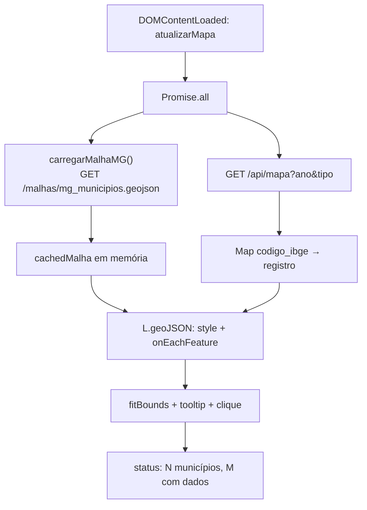

# Frontend — Vite + Leaflet

## Stack

| Item | Versão | Papel |
|---|---|---|
| Vite | ^6.0.0 | Dev server + bundler |
| Leaflet | ^1.9.4 | Mapa, camadas GeoJSON, tooltips |
| JavaScript | ES modules, vanilla | Sem framework, sem transpilação de JSX |

Sem CSS framework: `src/style.css` (182 linhas) define topbar, filtros, layout
mapa+painel e estados de cor.

```
frontend/
├── index.html              # shell acessível: topbar, filtros, mapa, painel
├── src/main.js             # toda a lógica (195 linhas)
├── src/style.css
├── public/malhas/mg_municipios.geojson   # 853 features, 489 KB
├── vite.config.js          # proxy /api → VITE_API_TARGET
└── Dockerfile              # node:22-alpine, npm run dev -- --host 0.0.0.0
```

## Fluxo de carga



A malha é baixada **uma vez** por sessão (`cachedMalha`); trocar indicador/ano só
refaz a chamada de API e re-estiliza as camadas.

## Coroplético

`corPorValor()` usa `taxa_100k` quando existir e cai para `valor_absoluto`:

| Faixa | Cor |
|---|---|
| `≥ 50` | `#581c87` |
| `≥ 15` | `#7e22ce` |
| `≥ 5` | `#a855f7` |
| `> 0` | `#d8b4fe` |
| `0` | `#e2e8f0` |
| `null`/`undefined` | `#cbd5e1` (sem dado) |

> **Atenção:** hoje `taxa_100k` é `null` em 100% dos registros (a coluna
> `municipios.populacao` nunca é preenchida), então a escala está sendo aplicada
> sobre **valores absolutos** — Belo Horizonte satura a faixa mais escura e
> municípios pequenos ficam claros. Ver
> [lacunas do banco](banco-de-dados.md#lacunas-conhecidas).

A junção malha↔API é por `feature.properties.codarea` (código IBGE de 7 dígitos
que o IBGE devolve no GeoJSON).

## Interações

| Ação | Efeito |
|---|---|
| Clique em município | `GET /api/municipio/{cod}` e preenche o painel lateral |
| Troca de `select-tipo` / `select-ano` | `atualizarMapa()` (nova consulta + restyle) |
| Busca (`input[list]` + `datalist`) | Resolve nome → código via `Map` normalizado em minúsculas, dá `fitBounds` no layer e abre o detalhe |
| `Esc` ou botão "Saída rápida" | `window.location.replace()` para uma página neutra (previsão do tempo) |
| Tooltip no hover | `Nome — valor_absoluto` ou `IBGE <código>` |

O painel monta HTML por template string com `innerHTML`: metadados, `<ul>` de
série histórica (ano, tipo, valor, taxa, link da fonte) e rede de apoio quando
existir.

## Proxy e ambientes

`vite.config.js` lê `VITE_API_TARGET` (default `http://localhost:8080`) e faz
proxy de `/api` com `changeOrigin`. No Compose a variável aponta para
`http://backend:8080` (DNS interno da rede Docker), então o browser nunca fala
com a API diretamente — não há CORS.

O container roda `npm run dev -- --host 0.0.0.0` (porta 5173): **é ambiente de
desenvolvimento**, com HMR. Para produção: `npm run build` e servir `dist/` com
proxy equivalente para `/api`.

## Acessibilidade e segurança da usuária

Implementado:
- `<html lang="pt-BR">`, `<label>` em cada filtro, `role="region"` + `aria-label` no mapa, `type="button"` no botão de saída.
- Saída rápida por teclado (`Esc`) e por botão — requisito de segurança física, não conveniência.
- Link do Ligue 180 sempre visível na topbar; links externos com `rel="noopener noreferrer"`.
- Nota metodológica sobre subnotificação fixa no painel.

Lacunas:
- `#status-msg` e `#panel-title` não são `aria-live` — troca de estado não é anunciada por leitor de tela.
- Contraste das faixas mais claras (`#d8b4fe`, `#e2e8f0`) sobre branco não foi auditado.
- Mapa não tem alternativa textual (tabela de dados).
- `innerHTML` com dados da API: conteúdo vem de base oficial, mas não há escape explícito.

## Lacunas conhecidas

1. `select-ano` lista apenas 2023–2026; o banco tem 2014–2026.
2. `select-tipo` oferece `violencia_saude` e `ligue_180`, sem dados importados ainda.
3. Sem build de produção servido pelo Compose.
4. Sem testes de UI.
