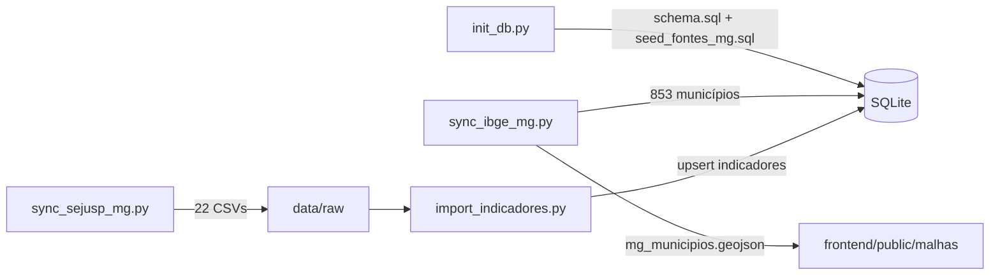

# Ingestão de dados

## Fontes oficiais

| Fonte | Órgão | Dataset | Indicador | Cobertura |
|---|---|---|---|---|
| SEJUSP-MG | Secretaria de Justiça e Segurança Pública de MG | [dados.mg.gov.br/dataset/violencia-contra-mulher](https://dados.mg.gov.br/dataset/violencia-contra-mulher) | `feminicidio`, `violencia_domestica` | 2018–2026 / 2014–2026 |
| SES-MG (SINAN) | Secretaria de Saúde de MG | [dados.mg.gov.br/dataset/violencia_ses](https://dados.mg.gov.br/dataset/violencia_ses) | `violencia_saude` | previsto |
| Ligue 180 | Ministério das Mulheres | [painel de dados](https://www.gov.br/mulheres/pt-br/ligue180/painel-de-dados) | `ligue_180` | previsto |
| IBGE | Localidades + Malhas v3 | `servicodados.ibge.gov.br` | municípios + GeoJSON | UF 31 |
| TRT-3 / Casa da Mulher Mineira | Judiciário / PCMG | páginas institucionais | `rede_apoio` | manual, não implementado |

## Pipeline



Execução completa, do zero:

```bash
python3 scripts/init_db.py          # 1. schema + catálogo de fontes
python3 scripts/sync_ibge_mg.py     # 2. municípios + malha (precisa de rede)
python3 scripts/sync_sejusp_mg.py   # 3. baixa 22 CSVs e importa
docker compose restart backend      # 4. solta o -shm antigo (WAL)
```

## 1. `init_db.py` (30 linhas)

Cria `data/` e executa `data/schema.sql` + `data/seed_fontes_mg.sql` via
`executescript`. Tudo `IF NOT EXISTS` / `INSERT OR IGNORE`: rodar de novo é no-op.
Imprime contagem de fontes, municípios e indicadores e sugere o próximo passo.

## 2. `sync_ibge_mg.py` (66 linhas)

Duas chamadas, sem autenticação, via `urllib`:

| Passo | Endpoint | Resultado |
|---|---|---|
| 1/2 | `GET /api/v1/localidades/estados/31/municipios` | upsert em `municipios` (código, nome, micro, meso) |
| 2/2 | `GET /api/v3/malhas/estados/31?intrarregiao=municipio&qualidade=minima&formato=application/vnd.geo+json` | grava `frontend/public/malhas/mg_municipios.geojson` (~489 KB) |

`qualidade=minima` é escolha deliberada: 489 KB de malha simplificada em vez de
dezenas de MB, sem perda visual no zoom 5–13 do mapa.

`User-Agent` próprio (`mapa-violencia-genero-mg/0.1`) — o IBGE recusa requisições
sem UA identificado de forma consistente.

**Não busca população** — daí `populacao` ficar `NULL` (ver
[lacunas](banco-de-dados.md#lacunas-conhecidas)).

## 3. `sync_sejusp_mg.py` (61 linhas)

Descobre os recursos pelo **CKAN API** do portal mineiro:

```
GET https://dados.mg.gov.br/api/3/action/package_show?id=violencia-contra-mulher
```

- `User-Agent` de browser real (Chrome/Linux): o portal responde **403** ao UA
  padrão do `urllib`/`curl`.
- Filtra `format == "CSV"`, classifica o `tipo` pelo nome do recurso
  (`"feminicidio" in nome` → `feminicidio`, senão `violencia_domestica`).
- Baixa para `data/raw/<nome-do-recurso>.csv` só o que falta; `--refresh` rebaixa tudo.
- Reusa `import_indicadores.import_csv()` com `Namespace` montado à mão — uma única
  implementação de parsing para os dois caminhos.

## 4. `import_indicadores.py` (319 linhas) — o núcleo

Sem dependências externas: `csv`, `sqlite3`, `unicodedata`, `argparse`.

### Robustez de leitura

| Problema real nos CSVs | Tratamento |
|---|---|
| BOM UTF-8, arquivos em `cp1252`/`latin-1` | tenta `utf-8-sig → utf-8 → cp1252 → latin-1` |
| `;` vs `,` vs tab | `csv.Sniffer` com fallback pela contagem de separadores |
| Cabeçalhos com acento/espaço/hífen | `normalize_text` (NFKD, sem acento, minúsculas, `-`/`/` → espaço) |
| Números com milhar `1.234` e decimal `1,5` | `parse_int` / `parse_float` com desempate `,`/`.` |
| Ano dentro de data (`2025-06-27`) | `parse_year` extrai o primeiro bloco de 4 dígitos iniciado em `19`/`20` |
| Código IBGE de 6 dígitos (SINAN/DATASUS) | `load_mg_municipios` registra o prefixo de 6 dígitos de cada código de 7 |
| Município só por nome | `lookup[normalize_text(nome)]` |

### Mapeamento de colunas (default por fonte)

| Campo | `sejusp_mg` | `ses_mg` | `ligue180` |
|---|---|---|---|
| município | `municipio_cod`, `municipio_fato`, `cod_ibge`… | `municipio_residencia`, `id_mn_resi`… | `municipio`, `municipio_vitima`… |
| ano | `ano`, `ano_fato`, `data_fato` | `ano`, `nu_ano`, `dt_notific` | `ano`, `data_de_cadastro` |
| valor | `qtde_vitimas`, `registros`… | `quantidade`, `casos`… | `quantidade`, `denuncias`… |
| taxa | `taxa`, `taxa_100k` | `taxa`, `taxa_100k` | `taxa`, `taxa_100k` |
| filtro | `natureza`, `tipo_crime`, `tentado_consumado` | `tipo_violencia`, `viol_fisic`… | `violacao`, `tipo_violencia` |

Qualquer coluna pode ser forçada por flag: `--col-municipio`, `--col-ano`,
`--col-valor`, `--col-taxa`, `--filtro-coluna`, `--filtro-valor`.

### Regras de agregação

1. **Filtro** opcional por substring normalizada (ex.: `--filtro-valor TENTADO`).
2. **Município**: resolve por dígitos (6 ou 7) ou nome normalizado; linha sem match é descartada e contabilizada (`fora de MG/sem match`).
3. **Ano**: coluna, data, ou `--ano-fixo` quando o CSV não tem ano.
4. **Valor**: soma da coluna de contagem; sem coluna de contagem, conta **1 por linha** (útil para SINAN linha-a-linha).
5. **Taxa**: média das taxas presentes no CSV; senão `valor / populacao * 100000`; senão `NULL`.
6. **Gravação**: um registro por `(município, ano)`, com
   `ON CONFLICT (codigo_ibge, ano, tipo, fonte_id) DO UPDATE` — idempotente,
   e `COALESCE(excluded.taxa_100k, indicadores.taxa_100k)` preserva a taxa antiga
   quando a nova é `NULL`.
7. Atualiza `fontes.data_atualizacao` com a data corrente.

`--dry-run` mostra as 10 primeiras linhas agregadas sem gravar — **use sempre** ao
apontar para um CSV novo.

### Exemplo de saída

```
CSV lido (utf-8-sig, delimitador ';'): 1342 linhas | 1342 após filtro |
0 fora de MG/sem match | 128 pares (município, ano)
Importação concluída: 128 registros gravados em data/violencia_mg.db.
```

## Adicionar uma nova fonte (receita)

1. `INSERT OR IGNORE` em `fontes` (`slug`, `nome`, `orgao`, `url_oficial`, `nota_metodologica`) — via `data/seed_fontes_mg.sql`.
2. Rodar `import_indicadores.py --fonte <slug> --tipo <novo_tipo> --csv <arquivo> --dry-run`.
3. Conferir a contagem de linhas descartadas e um par `(município, ano)` na mão.
4. Importar de verdade e validar com `SELECT tipo, COUNT(*) FROM indicadores GROUP BY tipo`.
5. Adicionar o `<option>` correspondente em `frontend/index.html` se ainda não existir.

## Qualidade e vieses

- **Subnotificação**: município sem DEAM registra menos — ausência de registro não é ausência de violência. A UI declara isso no painel.
- **2026 é ano em curso**: os totais de 2026 são parciais e não comparáveis a anos fechados.
- **Sobreposição de fontes**: SEJUSP (ocorrência policial) e SINAN (notificação de saúde) contam coisas diferentes; nunca somar `tipo` distintos.
- **Divergência de código**: 6 vs 7 dígitos já tratada; nomes homônimos em UFs diferentes são resolvidos pelo código, não pelo nome.
- Os CSVs brutos (133 MB) **não vão para o Git** — são regeneráveis por `sync_sejusp_mg.py`.
