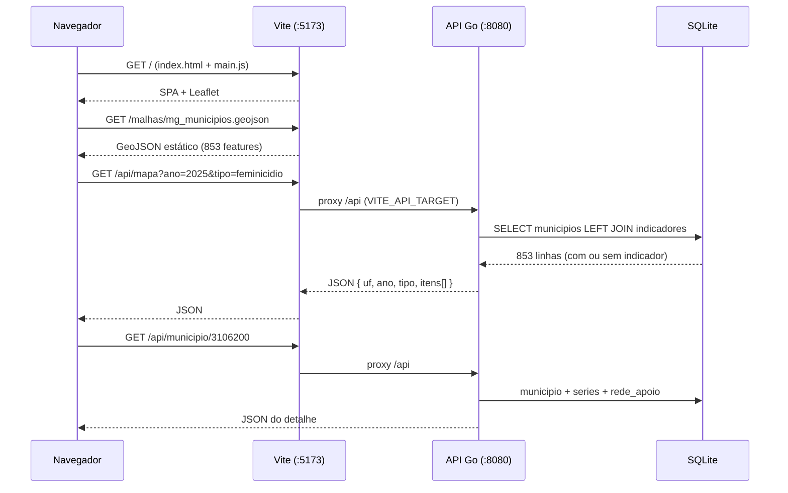

# Visão geral da arquitetura

## Problema e escopo

Publicar, de forma acessível e verificável, a evolução municipal da violência de
gênero em **Minas Gerais**, a partir de bases oficiais abertas. O produto é um
mapa coroplético com filtros por indicador e ano, mais uma ficha por município
com série histórica e rede de apoio.

Alinhamento com os ODS:

- **ODS 5, meta 5.2** — eliminar todas as formas de violência contra mulheres e meninas.
- **ODS 16, metas 16.1, 16.3 e 16.6** — reduzir violência, ampliar acesso à justiça, instituições transparentes.

## Requisitos que moldaram o desenho

| Requisito | Consequência arquitetural |
|---|---|
| Rodar em máquina modesta, sem cloud | SQLite em arquivo; backend Go com `mem_limit: 128m` |
| Dados somente leitura, volumetria de milhares de linhas | Sem ORM, sem cache distribuído, sem fila |
| Reprodutibilidade a partir das fontes oficiais | Pipeline de ingestão idempotente em Python stdlib |
| Privacidade da usuária (risco de violência doméstica) | Saída rápida (`Esc`), nenhum dado individual, agregação municipal |
| Ser material didático (Alura) | Stack mínima: `net/http` puro, Leaflet vanilla, zero framework JS |

## Componentes

| Componente | Tecnologia | Responsabilidade |
|---|---|---|
| Ingestão | Python 3 (stdlib) | Baixar, normalizar e gravar CSVs oficiais no SQLite |
| Banco | SQLite 3, modo WAL | Fonte de verdade local, um arquivo por ambiente |
| API | Go 1.22, `net/http`, `modernc.org/sqlite` | Consultas de leitura em JSON, sem CGO |
| Web | Vite 6 + Leaflet 1.9 | Mapa, filtros, ficha do município |
| Orquestração local | Docker Compose | Dois containers, volumes e limites de memória |

## Fluxo de uma requisição

## Decisões e trade-offs

| Decisão | Alternativa descartada | Por quê |
|---|---|---|
| SQLite em arquivo | Postgres em container | Volumetria < 15 mil linhas, leitura pura, zero administração; Postgres custaria ~200 MB de RAM para nada |
| `net/http` + `ServeMux` (padrão de método/rota do Go 1.22) | Chi, Gin, Echo | 5 rotas não justificam framework; menos dependência = menos superfície |
| `modernc.org/sqlite` (Go puro) | `mattn/go-sqlite3` (CGO) | Binário estático em `alpine`, build sem toolchain C |
| Ingestão em Python stdlib | pandas/dbt/Airflow | Os CSVs têm cabeçalhos inconsistentes; 300 linhas de Python resolvem e não exigem instalação |
| Leaflet + GeoJSON simplificado do IBGE | Mapbox/deck.gl | Sem chave de API, 489 KB de malha, funciona offline |
| Vite dev server no Compose | Build estático + Nginx | O objetivo é ambiente de estudo; build de produção é um passo separado (`npm run build`) |
| Agregação por `(município, ano)` na ingestão | Agregar no SQL a cada request | Consulta do mapa fica um `LEFT JOIN` simples, sem `GROUP BY` |

## O que o sistema deliberadamente não tem

- Autenticação/autorização — API pública, somente leitura.
- Escrita via API — atualização de dados é batch, fora do caminho de request.
- Cache/CDN/fila — o gargalo é a fonte, não a API.
- Multi-UF — o código fixa `uf=MG` e `estado/31` nas URLs do IBGE.
- Dados individuais — ver [Segurança e privacidade](seguranca-e-privacidade.md).

## Estado atual do dataset

| Indicador | Fonte | Período | Registros |
|---|---|---|---|
| `feminicidio` | SEJUSP-MG | 2018–2026 | 1.613 |
| `violencia_domestica` | SEJUSP-MG | 2014–2026 | 11.088 |
| `violencia_saude` | SES-MG (SINAN) | — | 0 (fonte cadastrada, importador pronto) |
| `ligue_180` | Ligue 180 | — | 0 (fonte cadastrada, importador pronto) |

Municípios: 853. Rede de apoio: tabela vazia (ver [lacunas](banco-de-dados.md#lacunas-conhecidas)).
